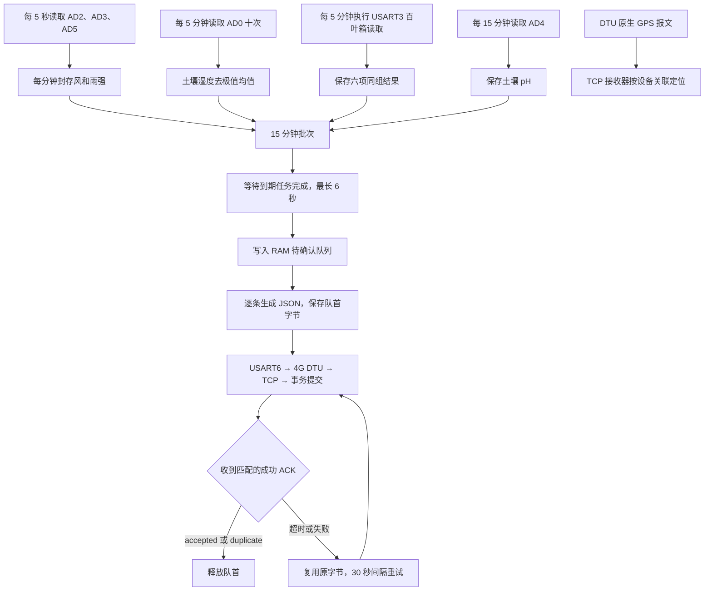

# Tea Sense Telemetry Protocol V1.0

适用固件为 STM32H743 `0.12.0-dev`，标定版本为 `baseline-3`。本文件定义固件与 TCP 接收器的接口。接收器可以独立选择 SQLite、PostgreSQL 和前端数据模型。

## 数据流



ADC 对应 AD0 土壤湿度、AD2 风速、AD3 风向、AD4 pH 和 AD5 雨强。现有 pH 硬件路径为 AD4 ADC。百叶箱沿用 USART3 的四次 Modbus RTU 寄存器查询，六个字段同组。风和雨传感器输出瞬时量。

## 传输与信封

- 上行使用 UTF-8 JSON，每个对象以 CRLF 结尾。USART6 使用原有 115200、8N1，4G DTU 透明传输。TCP 接收器需要支持跨分段对象、连续对象及可选的空分隔行。串口故障恢复可在重传前加一组 CRLF，JSON 对象及其结束符字节保持一致。
- 固定字段为 `protocol="tea_sense.telemetry"`、`schema_version="1.0"`（字符串）、`upload_interval_s=900`。外层 `token` 是既有私有鉴权字段，最多 256 个 Unicode 字符。固件使用预转义的 JSON 字符串，接收器应使用解析后的字符串进行比较。
- `device_id` 取 `APP_DEVICE_ID`，缺省为 `tea_h743_001`，允许 1～64 个 ASCII 字母、数字、下划线或短横线。`seq` 是 uint32，由当前启动会话内第一个闭合窗口的 1 开始按窗口递增。跳过或者丢弃的窗口可造成序号间隔。
- `batch_id` 由 `device_id:boot_session_id:seq` 组成。开机从 H743 硬件 RNG 读取四个 32 位字，前三个分别与芯片 96 位 UID 的三个字异或，按字输出 32 位小写十六进制字符。硬件随机数提供 128 位会话熵，跨重启重复的概率取决于 RNG 的实际熵。固件在生成会话前继续采集和缓存，待会话就绪后发送。
- `data` 始终含五个数组。数组长度就是实际记录数。到期且失败的槽位保留并写入质量状态。重启后从新的窗口起点采集，旧会话未完成数据随 RAM 队列清空。`COMPLETE` 要求五组齐全且每项计划样本和主要测量值均有效。出现缺槽、部分样本、静风方向或其他无效值时为 `PARTIAL`。

## 时间含义

当前 RTC 未启用，固件只有 HAL 单调计时。当前版本发出 `time_valid=false`，`window_start_ts`、`window_end_ts`、`upload_ts` 及所有记录的 `ts` 都为 `null`。UTC 有效时，这些字段的单位为 Unix 秒。接收时间可由服务器另存为 `received_at`。

| 字段 | 当前含义 |
| --- | --- |
| `window_start_uptime_ms`、`window_end_uptime_ms` | 本批逻辑窗口边界，相差 900000 ms |
| 外层 `uptime_ms` | 首次开始生成本批 JSON 的设备计时 |
| 风、雨组的 `uptime_ms` | 对应一分钟统计窗口结束时刻 |
| 土壤湿度、pH、百叶箱的 `uptime_ms` | 土壤最后一次 ADC 完成、pH 读取完成、百叶箱本组最后一次事务完成。到期后完全未执行时使用槽位时刻，并以质量状态说明缺测 |
| 慢速组的 `slot_uptime_ms` | 计划槽位，归入 `(window_start, window_end]`。第 15 分钟触发的采集实际完成时间可晚于窗口末端，最长等待 6000 ms |

计时均为 uint32 毫秒，接收器按同一 `boot_session_id` 展开回绕。两刻之差可用 `(new - old) & 0xFFFFFFFF`。首发组包时间随字节一起封存，重传时仍表示首发组包时刻。具备可靠 UTC 后，分钟组的 `ts` 对应分钟结束，慢速组的 `ts` 对应实际完成，`upload_ts` 对应首次组包时刻。计划槽位决定批次归属。

## 数据记录

JSON 数字使用定点格式和十进制小数点。合法测量值 0 保留。测量无效时使用 JSON `null`。`sample_count` 表示计划样本数。`quality` 使用 `OK`、`PARTIAL`、`INVALID`，`CALM` 只用于 `direction_quality`。所有记录均含独立的 `ts` 和 `uptime_ms`。

| 组 | 每批计划条数 | 业务字段和规则 |
| --- | ---: | --- |
| `soil_moisture` | 3 | `slot_uptime_ms`、`moisture_pct`（%）、`sample_count`=10、`valid_count`、`aggregation="trimmed_mean"`、`quality`。200 ms 间隔取十次，十次全有效时去掉一个最大值和一个最小值，余八点求平均。1～9 点为 `PARTIAL`，0 点为 `INVALID`，两种情况下值均为 `null`。 |
| `soil_ph` | 1 | `slot_uptime_ms`、`ph`、`quality`。沿用 AD4 校准，失败使用 `null` 和 `INVALID`。 |
| `wind` | 15 | `speed_avg_m_s`（m/s）、`direction_avg_deg`（[0, 360)°）、`sample_count`=12、`speed_valid_count`、`direction_valid_count`、`speed_aggregation="arithmetic_mean"`、`direction_aggregation="circular_mean"`、`quality`、`direction_quality`。风速按实际有效点平均。风向计数为参与圆周统计的非静风有效配对数，按 sin、cos、atan2 处理。平均风速低于 0.30 m/s 时为 `CALM`。有效方向少于 3 个或合成向量长度低于 0.20 时方向为 `INVALID`。两者角度均为 `null`。 |
| `rain` | 15 | `intensity_avg_mm_min` 与 `intensity_max_mm_min`，单位 mm/min，`sample_count`=12、`valid_count`、`aggregation="arithmetic_mean"`、`quality`。平均值和峰值都来自全部有效点。全失败时两者为 `null`。分钟峰值为附加统计。 |
| `weather_box` | 3 | `slot_uptime_ms`、`temperature_c`（°C）、`humidity_rh_pct`（%RH）、`light_lx`（lx）、`pressure_kpa`（kPa）、`pm25_ug_m3` 与 `pm10_ug_m3`（μg/m³）、`quality`。六项共享一次组时刻，单项失败单项为空，1～5 项有效报 `PARTIAL`，零项报 `INVALID`。 |

每批计划 67 个主要测量值，另含 15 个雨强峰值。雨强代表单位时间强度。

## ACK 与重传

初次入库并提交后回复以下 ACK。重复批次已经提交且内容一致时，用相同标识回复 `status="duplicate"`。

```json
{
  "protocol": "tea_sense.ack",
  "schema_version": "1.0",
  "device_id": "tea_h743_001",
  "seq": 1,
  "batch_id": "tea_h743_001:aad5f011d8a7b3595f0bc0202056e7b7:1",
  "status": "accepted"
}
```

ACK 同样以 CRLF 结束。固件核对 `protocol`、`schema_version`、`device_id`、`seq` 和 `batch_id`，只把 `accepted` 和 `duplicate` 当作成功。最大标识下的紧凑 ACK 为 292 字节。服务端按 `(device_id, batch_id)` 幂等，持久化提交在回复之前。同 ID 内容冲突时应返回不同于以上两种的状态，或终止该帧的确认。

USART6 发送完成后等待 ACK 10 秒。失败保留队首，距上次尝试约 30 秒再试。同批重传复用原 JSON、该批采集时刻及首发组包时刻。下一待发批与成功 ACK 间隔至少 1 秒。队列最多 96 批，相当于约 24 小时，取决于断网前已占用空间。满队列保留旧数据，拒收新批并增加 `AppBatch_Overflows()` 计数。掉电或重启会丢失 RAM 中待确认数据。

## GPS 与部署

DTU 通过原生 `cmd="upload"` JSON 独立上报定位，现场配置目标周期为 60 秒。当前固件只在 USART6 下行处理 ACK，没有能供当前批次使用的已验证定位数据，因此上报包没有 `gps_snapshot`。接收器按同连接鉴权设备和私有 IMEI 绑定关联原生 GPS，以原生定位时间独立保存。将来可从可靠定位接口提供可选 `gps_snapshot`，字段为 `fix_ts`（UTC Unix 秒）、`longitude`、`latitude`、`quality="VALID"`。

本轮交付固件与协议。当前生产 Python 接收器仍识别之前的整数版本和 ACK，单对象上限为 8192 字节。切换现场前，先在隔离接收器完成字符串版本、事务去重、V1.0 ACK 和 GPS 关联适配，接收上限需能覆盖 12 KiB；再实测 4G DTU 的较长帧、串口持续传输、分段重组、断网积压后补传及 ACK 下行。实板烧录、硬件 RNG 和实际 4G 通道联调待验。

## 帧长与资源

- 按所有字段各自的最大宽度独立计算，帧长上界为 11845 字节，包含 CRLF。固件执行 12000 字节上限。完整样例为 8100 字节，最大字段和凭据用例为 11809 字节。预分配 12288 字节的 USART6 TX 缓冲区，其中前 2 字节保留用于串口故障恢复。编码需保留末尾 C 字符串终止符。超过预算或空间不足会报告格式错误。
- AXI RAM 中，批次队列 46080 字节，每批 480 字节。当前采集批次 480 字节，分步 JSON 状态 28 字节，UART RX 环 512 字节，ACK 行 512 字节。队首重试使用同一 TX 缓冲区。115200、8N1 下 12000 字节理论串行时间约 1.04 秒，BSP 发送超时为 1.5 秒。
- Keil ARMCC 5.06u7，0 个错误、0 个警告。链接报告 Code 43140、RO 2436、RW 148、ZI 65148 字节。

## 验证

| 项目 | 结果 |
| --- | --- |
| 土壤十点去极值、风向 350°/355°/5°/10°、有效风速不足、雨强全零和峰值 | 主机 C 与 JSON 用例通过 |
| 五组 67 值和 15 峰值、失败字段为空、缺槽数量、百叶箱部分失败、JSON 合法性、转义和边界 | 固件 C 生成，Python 标准库解析通过 |
| 跨模拟重启批次 ID、原字节重传、匹配 ACK、满队列、分步组包及 UART 发送期间的采样 | 模拟 HAL、隔离 TCP 确认端通过 |
| Keil 构建和 ARM 指令级模拟 | 通过，模拟两批完整帧及 ACK，观测到的应用栈峰值为 512 字节 |
| 现有服务器 | 原 55 项测试通过；测试使用临时数据 |

固件目录下可执行 `py -3 Tests/run_host_tests.py`、`py -3 Tests/check_server_upload.py`、`py -3 Tests/check_architecture.py` 和 `py -3 Tests/check_arm_build.py`。ARM 指令级模拟入口为 `Tests/check_arm_printf.py`，使用替代 HAL 与模拟 RNG。

## 修改文件

| 范围 | 文件 |
| --- | --- |
| 新增批次队列 | `App/Inc/app_batch.h`、`App/Src/app_batch.c` |
| 新增 V1.0 序列化 | `App/Inc/app_telemetry_json.h`、`App/Src/app_telemetry_json.c` |
| 批次结构、调度、组时刻 | `App/Inc/app_data.h`、`App/Inc/app_version.h`、`App/Src/app_main.c`、`App/Src/app_statistics.c`、`App/Src/app_weather.c` |
| 发送、ACK 与设备标识 | `App/Inc/app_upload.h`、`App/Src/app_upload.c`、`Bsp/Inc/bsp_config.h`、`Bsp/Inc/bsp_time.h`、`Bsp/Src/bsp_time.c`、`Bsp/Src/bsp_dtu.c`（缓冲配置） |
| 工程与测试 | `MDK-ARM/tea_sense.uvprojx`、`Tests/batch_cases.h`、`Tests/dtu_host_test.c`、`Tests/statistics_host_test.c`、`Tests/upload_wire_fixture.c`、`Tests/run_host_tests.py`、`Tests/check_server_upload.py`、`Tests/check_architecture.py`、`Tests/check_arm_build.py`、`Tests/check_arm_printf.py` |
| 文档 | `Docs/tea_sense_telemetry_protocol_v1.md`、`Docs/integration_v2.md` |

## 完整 JSON 样例

以下为主机模拟 HAL 驱动实际固件代码生成的首批。鉴权字段为测试值。

```json
{
  "protocol": "tea_sense.telemetry",
  "schema_version": "1.0",
  "device_id": "tea_h743_001",
  "seq": 1,
  "batch_id": "tea_h743_001:aad5f011d8a7b3595f0bc0202056e7b7:1",
  "upload_interval_s": 900,
  "window_start_ts": null,
  "window_end_ts": null,
  "upload_ts": null,
  "time_valid": false,
  "batch_status": "COMPLETE",
  "window_start_uptime_ms": 0,
  "window_end_uptime_ms": 900000,
  "uptime_ms": 901800,
  "data": {
    "soil_moisture": [
      {"ts": null, "uptime_ms": 301800, "slot_uptime_ms": 300000, "moisture_pct": 50.0, "sample_count": 10, "valid_count": 10, "aggregation": "trimmed_mean", "quality": "OK"},
      {"ts": null, "uptime_ms": 601800, "slot_uptime_ms": 600000, "moisture_pct": 50.0, "sample_count": 10, "valid_count": 10, "aggregation": "trimmed_mean", "quality": "OK"},
      {"ts": null, "uptime_ms": 901800, "slot_uptime_ms": 900000, "moisture_pct": 50.0, "sample_count": 10, "valid_count": 10, "aggregation": "trimmed_mean", "quality": "OK"}
    ],
    "soil_ph": [
      {"ts": null, "uptime_ms": 900000, "slot_uptime_ms": 900000, "ph": 6.3, "quality": "OK"}
    ],
    "wind": [
      {"ts": null, "uptime_ms": 60000, "speed_avg_m_s": 11.71, "direction_avg_deg": 249.59, "sample_count": 12, "speed_valid_count": 12, "direction_valid_count": 12, "speed_aggregation": "arithmetic_mean", "direction_aggregation": "circular_mean", "quality": "OK", "direction_quality": "OK"},
      {"ts": null, "uptime_ms": 120000, "speed_avg_m_s": 11.71, "direction_avg_deg": 249.59, "sample_count": 12, "speed_valid_count": 12, "direction_valid_count": 12, "speed_aggregation": "arithmetic_mean", "direction_aggregation": "circular_mean", "quality": "OK", "direction_quality": "OK"},
      {"ts": null, "uptime_ms": 180000, "speed_avg_m_s": 11.71, "direction_avg_deg": 249.59, "sample_count": 12, "speed_valid_count": 12, "direction_valid_count": 12, "speed_aggregation": "arithmetic_mean", "direction_aggregation": "circular_mean", "quality": "OK", "direction_quality": "OK"},
      {"ts": null, "uptime_ms": 240000, "speed_avg_m_s": 11.71, "direction_avg_deg": 249.59, "sample_count": 12, "speed_valid_count": 12, "direction_valid_count": 12, "speed_aggregation": "arithmetic_mean", "direction_aggregation": "circular_mean", "quality": "OK", "direction_quality": "OK"},
      {"ts": null, "uptime_ms": 300000, "speed_avg_m_s": 11.71, "direction_avg_deg": 249.59, "sample_count": 12, "speed_valid_count": 12, "direction_valid_count": 12, "speed_aggregation": "arithmetic_mean", "direction_aggregation": "circular_mean", "quality": "OK", "direction_quality": "OK"},
      {"ts": null, "uptime_ms": 360000, "speed_avg_m_s": 11.71, "direction_avg_deg": 249.59, "sample_count": 12, "speed_valid_count": 12, "direction_valid_count": 12, "speed_aggregation": "arithmetic_mean", "direction_aggregation": "circular_mean", "quality": "OK", "direction_quality": "OK"},
      {"ts": null, "uptime_ms": 420000, "speed_avg_m_s": 11.71, "direction_avg_deg": 249.59, "sample_count": 12, "speed_valid_count": 12, "direction_valid_count": 12, "speed_aggregation": "arithmetic_mean", "direction_aggregation": "circular_mean", "quality": "OK", "direction_quality": "OK"},
      {"ts": null, "uptime_ms": 480000, "speed_avg_m_s": 11.71, "direction_avg_deg": 249.59, "sample_count": 12, "speed_valid_count": 12, "direction_valid_count": 12, "speed_aggregation": "arithmetic_mean", "direction_aggregation": "circular_mean", "quality": "OK", "direction_quality": "OK"},
      {"ts": null, "uptime_ms": 540000, "speed_avg_m_s": 11.71, "direction_avg_deg": 249.59, "sample_count": 12, "speed_valid_count": 12, "direction_valid_count": 12, "speed_aggregation": "arithmetic_mean", "direction_aggregation": "circular_mean", "quality": "OK", "direction_quality": "OK"},
      {"ts": null, "uptime_ms": 600000, "speed_avg_m_s": 11.71, "direction_avg_deg": 249.59, "sample_count": 12, "speed_valid_count": 12, "direction_valid_count": 12, "speed_aggregation": "arithmetic_mean", "direction_aggregation": "circular_mean", "quality": "OK", "direction_quality": "OK"},
      {"ts": null, "uptime_ms": 660000, "speed_avg_m_s": 11.71, "direction_avg_deg": 249.59, "sample_count": 12, "speed_valid_count": 12, "direction_valid_count": 12, "speed_aggregation": "arithmetic_mean", "direction_aggregation": "circular_mean", "quality": "OK", "direction_quality": "OK"},
      {"ts": null, "uptime_ms": 720000, "speed_avg_m_s": 11.71, "direction_avg_deg": 249.59, "sample_count": 12, "speed_valid_count": 12, "direction_valid_count": 12, "speed_aggregation": "arithmetic_mean", "direction_aggregation": "circular_mean", "quality": "OK", "direction_quality": "OK"},
      {"ts": null, "uptime_ms": 780000, "speed_avg_m_s": 11.71, "direction_avg_deg": 249.59, "sample_count": 12, "speed_valid_count": 12, "direction_valid_count": 12, "speed_aggregation": "arithmetic_mean", "direction_aggregation": "circular_mean", "quality": "OK", "direction_quality": "OK"},
      {"ts": null, "uptime_ms": 840000, "speed_avg_m_s": 11.71, "direction_avg_deg": 249.59, "sample_count": 12, "speed_valid_count": 12, "direction_valid_count": 12, "speed_aggregation": "arithmetic_mean", "direction_aggregation": "circular_mean", "quality": "OK", "direction_quality": "OK"},
      {"ts": null, "uptime_ms": 900000, "speed_avg_m_s": 11.71, "direction_avg_deg": 249.59, "sample_count": 12, "speed_valid_count": 12, "direction_valid_count": 12, "speed_aggregation": "arithmetic_mean", "direction_aggregation": "circular_mean", "quality": "OK", "direction_quality": "OK"}
    ],
    "rain": [
      {"ts": null, "uptime_ms": 60000, "intensity_avg_mm_min": 4.0, "intensity_max_mm_min": 4.0, "sample_count": 12, "valid_count": 12, "aggregation": "arithmetic_mean", "quality": "OK"},
      {"ts": null, "uptime_ms": 120000, "intensity_avg_mm_min": 4.0, "intensity_max_mm_min": 4.0, "sample_count": 12, "valid_count": 12, "aggregation": "arithmetic_mean", "quality": "OK"},
      {"ts": null, "uptime_ms": 180000, "intensity_avg_mm_min": 4.0, "intensity_max_mm_min": 4.0, "sample_count": 12, "valid_count": 12, "aggregation": "arithmetic_mean", "quality": "OK"},
      {"ts": null, "uptime_ms": 240000, "intensity_avg_mm_min": 4.0, "intensity_max_mm_min": 4.0, "sample_count": 12, "valid_count": 12, "aggregation": "arithmetic_mean", "quality": "OK"},
      {"ts": null, "uptime_ms": 300000, "intensity_avg_mm_min": 4.0, "intensity_max_mm_min": 4.0, "sample_count": 12, "valid_count": 12, "aggregation": "arithmetic_mean", "quality": "OK"},
      {"ts": null, "uptime_ms": 360000, "intensity_avg_mm_min": 4.0, "intensity_max_mm_min": 4.0, "sample_count": 12, "valid_count": 12, "aggregation": "arithmetic_mean", "quality": "OK"},
      {"ts": null, "uptime_ms": 420000, "intensity_avg_mm_min": 4.0, "intensity_max_mm_min": 4.0, "sample_count": 12, "valid_count": 12, "aggregation": "arithmetic_mean", "quality": "OK"},
      {"ts": null, "uptime_ms": 480000, "intensity_avg_mm_min": 4.0, "intensity_max_mm_min": 4.0, "sample_count": 12, "valid_count": 12, "aggregation": "arithmetic_mean", "quality": "OK"},
      {"ts": null, "uptime_ms": 540000, "intensity_avg_mm_min": 4.0, "intensity_max_mm_min": 4.0, "sample_count": 12, "valid_count": 12, "aggregation": "arithmetic_mean", "quality": "OK"},
      {"ts": null, "uptime_ms": 600000, "intensity_avg_mm_min": 4.0, "intensity_max_mm_min": 4.0, "sample_count": 12, "valid_count": 12, "aggregation": "arithmetic_mean", "quality": "OK"},
      {"ts": null, "uptime_ms": 660000, "intensity_avg_mm_min": 4.0, "intensity_max_mm_min": 4.0, "sample_count": 12, "valid_count": 12, "aggregation": "arithmetic_mean", "quality": "OK"},
      {"ts": null, "uptime_ms": 720000, "intensity_avg_mm_min": 4.0, "intensity_max_mm_min": 4.0, "sample_count": 12, "valid_count": 12, "aggregation": "arithmetic_mean", "quality": "OK"},
      {"ts": null, "uptime_ms": 780000, "intensity_avg_mm_min": 4.0, "intensity_max_mm_min": 4.0, "sample_count": 12, "valid_count": 12, "aggregation": "arithmetic_mean", "quality": "OK"},
      {"ts": null, "uptime_ms": 840000, "intensity_avg_mm_min": 4.0, "intensity_max_mm_min": 4.0, "sample_count": 12, "valid_count": 12, "aggregation": "arithmetic_mean", "quality": "OK"},
      {"ts": null, "uptime_ms": 900000, "intensity_avg_mm_min": 4.0, "intensity_max_mm_min": 4.0, "sample_count": 12, "valid_count": 12, "aggregation": "arithmetic_mean", "quality": "OK"}
    ],
    "weather_box": [
      {"ts": null, "uptime_ms": 300900, "slot_uptime_ms": 300000, "temperature_c": -5.5, "humidity_rh_pct": 45.6, "light_lx": 305419896, "pressure_kpa": 101.32, "pm25_ug_m3": 12, "pm10_ug_m3": 34, "quality": "OK"},
      {"ts": null, "uptime_ms": 600900, "slot_uptime_ms": 600000, "temperature_c": -5.5, "humidity_rh_pct": 45.6, "light_lx": 305419896, "pressure_kpa": 101.32, "pm25_ug_m3": 12, "pm10_ug_m3": 34, "quality": "OK"},
      {"ts": null, "uptime_ms": 900900, "slot_uptime_ms": 900000, "temperature_c": -5.5, "humidity_rh_pct": 45.6, "light_lx": 305419896, "pressure_kpa": 101.32, "pm25_ug_m3": 12, "pm10_ug_m3": 34, "quality": "OK"}
    ]
  },
  "token": "fixture\"token\\test"
}
```
